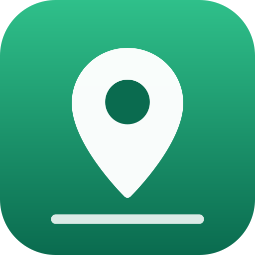

# PontoFato — skill and MCP server for AI agents



PontoFato gives an AI agent prepared address lookups and geographic joins with Brazilian company records.
Query a postal code (CEP), a street or a neighborhood without downloading and indexing both datasets.
The service returns IBGE 2022 address coordinates (CNEFE), available census tract context and companies
matched by CEP. Census tract figures describe the area, not the occupants of a building.
This repository packages the skill and remote MCP connection for Claude Code, Codex, Cursor and other agents.

**Site:** https://pontofato.com · **MCP server:** `https://pontofato.com/mcp?checkout=site` · **Prices:** https://pontofato.com/pricing ·
**API docs:** https://pontofato.com/developers

## What your agent can do

- Look up a CEP: addresses, latitude and longitude, with available census tract context.
- Search a street by name, in a state or a city, and list the units (apartments, shops) of a building.
- Find the address nearest to a coordinate and the CEPs within a radius of up to 2 km.
- List the companies registered at a CEP.
- Count active, opened and closed companies of an activity (CNAE) around a point, with the latest openings.

Try: *"Which restaurants opened near CEP 01310-100 in the last months?"* or
*"Find the coordinates of Avenida Paulista, 1000, São Paulo."*

## Install

Claude Code, as a plugin with the skill and the MCP server:

```
/plugin marketplace add wrpbr/pontofato
/plugin install pontofato@pontofato
```

Any agent that reads Agent Skills (Claude Code, Codex, Cursor, OpenCode and others):

```bash
npx skills add wrpbr/pontofato
```

Only the MCP server (remote, Streamable HTTP, no key for the free tools):

```bash
claude mcp add --transport http pontofato 'https://pontofato.com/mcp?checkout=site'   # Claude Code
codex mcp add pontofato --url 'https://pontofato.com/mcp?checkout=site'               # Codex
```

```json
{ "mcpServers": { "pontofato": { "url": "https://pontofato.com/mcp?checkout=site" } } }
```

The JSON above goes in `.cursor/mcp.json` for Cursor and in the MCP settings of most other clients. In Claude.ai and
Claude Desktop, open Settings → Connectors → Add custom connector and paste the server address.

## Price

The CEP lookup, the street search, the nearest address, the radius and the companies of a CEP are free and need no
key. The company count around a point (`vizinhanca`) has its own allowance; the API index tells when it is free. The
full CNPJ check gives a free allowance each day; after it, the check uses a pack or a plan. CEP lookup stays free. You buy
plans and prepaid credit on the site, and plans do not renew automatically. The plugin never pays: with
`checkout=site`, the MCP server has no purchase tool and no payment argument. The agent shows the price and the link,
and after your purchase it uses your credit token. The current prices are at https://pontofato.com/pricing.

For an agent authorized to pay, the direct `/mcp` also exposes existing per-call services without an account.
Read `/api/pricing` and `/api/billing` first. An x402 quote is in `structuredContent`;
retry with `params._meta["x402/payment"]` only within the user's budget.
The site offers Pix or card only when that method is enabled.

## What the plugin sends

The skill tells the agent to call the PontoFato API at pontofato.com. The MCP server also runs at pontofato.com.
Your queries (CEPs, street names, coordinates and activity codes) go to pontofato.com over HTTPS. A credit token goes
only when you give one for a paid call. The plugin runs no local program and reads no local file.

## Data and limits

Addresses come from the IBGE CNEFE of the 2022 Census. They do not prove that a CEP or an address is valid today.
Companies come from the public CNPJ dump of Receita Federal and are matched to addresses by CEP, so a company
distance is a CEP distance, not the exact building.
Check the base date, period and truncation. If `lenta` is true or a company count is missing,
report an incomplete result, not zero companies. That result does not consume the neighborhood allowance
or charge credit/x402. Reducing the radius changes the question; do it only when the user's task permits it.

## Em português

O PontoFato entrega consultas prontas de endereços e cruzamentos com empresas, sem baixar e indexar as duas bases.
O CEP traz os endereços com a coordenada do IBGE (CNEFE 2022), o contexto disponível do setor censitário
e as empresas relacionadas por CEP. Os números do setor descrevem a área, não os moradores de um imóvel. O agente também
busca rua, acha o endereço mais próximo de um ponto e conta as empresas de uma atividade num raio de até 2 km. Este
repositório traz a skill e a conexão com o servidor MCP remoto. Instale com os comandos acima. A consulta de CEP é
grátis e não pede chave. A compra é sempre no site, e o plugin nunca paga sozinho. Os preços estão em
https://pontofato.com/pricing.

## Files

| File | What it is |
|---|---|
| `skills/pontofato/SKILL.md` | The skill: which tool answers which question, the limits of the data and the rules for paid calls |
| `.mcp.json` | The remote MCP server of the plugin |
| `.claude-plugin/plugin.json` | The plugin manifest |
| `.claude-plugin/marketplace.json` | Lets Claude Code add this repository as a plugin marketplace |
| `server.json` | The manifest in the official MCP registry (`com.pontofato/pontofato`) |
| `glama.json` | The maintainer for the Glama MCP directory |

## License and contact

The files in this repository are under the MIT-0 license. The PontoFato service and its data are not part of this
license: their use follows the [terms of use](https://pontofato.com/termos) and the
[privacy policy](https://pontofato.com/privacidade). For questions or problems, open an issue here or write to
contato@pontofato.com.
